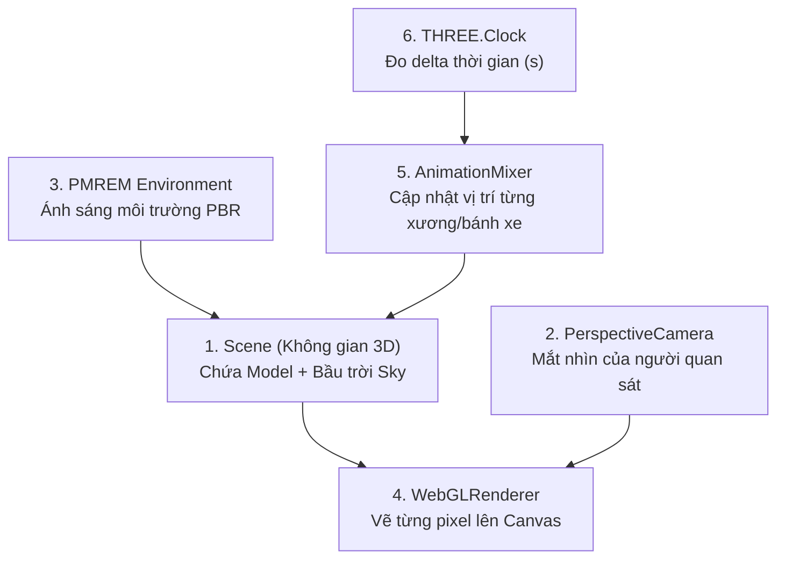

# 🎓 Giáo Trình Tự Học Three.js Từng Bước: Tái Hiện Demo Animation Keyframes (Littlest Tokyo)

> **Dành riêng cho:** Bạn (tác giả: `huypham1411`)  
> **Mục tiêu:** Hiểu sâu toàn bộ cơ chế hoạt động của WebGL, Three.js, hệ thống diễn hoạt 3D nén (DRACO + GLTF) và ánh sáng PBR thực tế.

---

## 📌 Mục Lục

1. [Tổng quan Kiến trúc Dự án](#1-tổng-quan-kiến-trúc-dự-án)
2. [Bước 1: Khởi tạo Scene, PerspectiveCamera & WebGLRenderer](#bước-1-khởi-tạo-scene-perspectivecamera--webglrenderer)
3. [Bước 2: Điều hướng Camera mượt mà với OrbitControls](#bước-2-điều-hướng-camera-mượt-mà-với-orbitcontrols)
4. [Bước 3: Môi trường Ánh sáng PBR Tự nhiên bằng Sky & PMREMGenerator](#bước-3-môi-trường-ánh-sáng-pbr-tự-nhiên-bằng-sky--pmremgenerator)
5. [Bước 4: Nạp Mô hình 3D nén qua DRACOLoader & GLTFLoader](#bước-4-nạp-mô-hình-3d-nén-qua-dracoloader--gltfloader)
6. [Bước 5: Kích hoạt Diễn hoạt Thời gian thực qua AnimationMixer](#bước-5-kích-hoạt-diễn-hoạt-thời-gian-thực-qua-animationmixer)
7. [Bước 6: Vòng lặp Render (Animation Loop) & Xử lý Delta Time](#bước-6-vòng-lặp-render-animation-loop--xử-lý-delta-time)
8. [Các bài thực hành mở rộng (Exercises)](#các-bài-thực-hành-mở-rộng-exercises)

---

## 1. Tổng quan Kiến trúc Dự án

Để hiển thị một vật thể 3D chuyển động trên trình duyệt, Three.js cần 4 thành phần thiết yếu liên kết với nhau:



---

## Bước 1: Khởi tạo Scene, PerspectiveCamera & WebGLRenderer

### 1.1 Khái niệm cốt lõi
* **`THREE.Scene`**: Là một biểu đồ phân cấp (Scene Graph) chứa toàn bộ đối tượng 3D, đèn chiếu và camera.
* **`THREE.PerspectiveCamera`**: Mô phỏng ống kính mắt người. Nhìn vật ở gần thì to, ở xa thì nhỏ theo luật phối cảnh 3 điểm tụ.
  - Cú pháp: `new THREE.PerspectiveCamera(fov, aspect, near, far)`
  - `fov` (Field of View): Góc mở đứng của ống kính (ở đây dùng `40` độ cho tiêu cự chuẩn mắt nhìn, không bị méo góc cá).
  - `aspect`: Tỉ lệ khung hình (chiều rộng / chiều cao).
  - `near / far`: Mặt phẳng cắt gần và xa. Vật thể nằm ngoài khoảng này sẽ bị GPU loại bỏ (Frustum Culling) để tiết kiệm tài nguyên.
* **`THREE.WebGLRenderer`**: Cây cầu kết nối mã JavaScript với chip đồ họa GPU qua thư viện WebGL.
  - `toneMapping = THREE.ACESFilmicToneMapping`: Thuật toán giả lập dải màu tương phản động cao (HDR) của máy quay phim điện ảnh, giúp màu trắng không bị "cháy" bết dính.

### 1.2 Code mẫu Bước 1
```javascript
import * as THREE from 'three';

const scene = new THREE.Scene();

const camera = new THREE.PerspectiveCamera(40, window.innerWidth / window.innerHeight, 1, 100);
camera.position.set(5, 2, 8);

const renderer = new THREE.WebGLRenderer({ antialias: true });
renderer.setPixelRatio(Math.min(window.devicePixelRatio, 2));
renderer.setSize(window.innerWidth, window.innerHeight);
renderer.toneMapping = THREE.ACESFilmicToneMapping;
renderer.toneMappingExposure = 1.0;
document.body.appendChild(renderer.domElement);
```

---

## Bước 2: Điều hướng Camera mượt mà với OrbitControls

### 2.1 Khái niệm cốt lõi
* Khi làm ứng dụng 3D, nếu camera đứng yên thì khung cảnh sẽ rất nhàm chán. `OrbitControls` cho phép người dùng dùng chuột (hoặc ngón tay trên điện thoại) để **xoay quanh một tâm điểm (target)**.
* **`enableDamping = true`**: Tạo cảm giác "quán tính trượt" khi thả chuột ra, camera không dừng đột ngột mà trượt nhẹ một đoạn ngắn rất êm ái.
* **`maxPolarAngle`**: Góc ngửa lên/xuống. Khóa ở `Math.PI / 2` (90 độ) để người dùng không thể xoay camera chui xuống dưới gầm hòn đảo.

### 2.2 Code mẫu Bước 2
```javascript
import { OrbitControls } from 'three/addons/controls/OrbitControls.js';

const controls = new OrbitControls(camera, renderer.domElement);
controls.enableDamping = true;
controls.dampingFactor = 0.05;
controls.target.set(0, 0.7, 0); // Ngắm vào trung tâm thành phố
controls.maxPolarAngle = Math.PI / 2 - 0.02; // Chống chìm xuống đất
controls.minDistance = 2; // Khoảng cách zoom gần nhất
controls.maxDistance = 25; // Khoảng cách zoom xa nhất
```

---

## Bước 3: Môi trường Ánh sáng PBR Tự nhiên bằng Sky & PMREMGenerator

### 3.1 Vì sao không cắm đèn thủ công?
Nếu dùng đèn thường (`DirectionalLight`, `PointLight`), các vật liệu PBR (kim loại, kính, sơn xe) sẽ trông rất khô cứng vì thiếu hình ảnh phản chiếu của thế giới xung quanh.

Three.js giải quyết bài toán này bằng **IBL (Image-Based Lighting)**:
1. Tạo một vòm trời mô phỏng khí quyển Trái Đất (`Sky`).
2. Dùng `PMREMGenerator` (Prefiltered Mipmapped Radiance Environment Map) chụp lại toàn bộ vòm trời và làm mờ theo độ nhám (roughness).
3. Gán vào `scene.environment`. Giờ đây mọi vật thể trong thành phố đều tự động nhận ánh sáng phản xạ 360 độ từ bầu trời hoàng hôn!

### 3.2 Code mẫu Bước 3
```javascript
import { Sky } from 'three/addons/objects/Sky.js';

const sky = new Sky();
sky.scale.setScalar(10000);
scene.add(sky);

const uniforms = sky.material.uniforms;
uniforms['turbidity'].value = 0.1;
uniforms['rayleigh'].value = 2.5;
uniforms['sunPosition'].value.set(-0.8, 0.19, 0.56); // Góc hoàng hôn

const pmremGenerator = new THREE.PMREMGenerator(renderer);
scene.environment = pmremGenerator.fromScene(sky).texture;
```

---

## Bước 4: Nạp Mô hình 3D nén qua DRACOLoader & GLTFLoader

### 4.1 Thuật toán nén Google Draco là gì?
File 3D thường chứa hàng triệu tọa độ đỉnh (vertex) và pháp tuyến (normal). Thuật toán **Draco** nén dữ liệu hình học này bằng cách lượng tử hóa (quantization) và nén entropy.
* File gốc: ~25 MB
* File sau nén Draco: **3.94 MB** (nhẹ hơn 84%, tải siêu nhanh trên mobile!)

Để đọc được file này, Three.js gọi một module WebAssembly riêng biệt (`draco_decoder.wasm`).

### 4.2 Code mẫu Bước 4
```javascript
import { GLTFLoader } from 'three/addons/loaders/GLTFLoader.js';
import { DRACOLoader } from 'three/addons/loaders/DRACOLoader.js';

const dracoLoader = new DRACOLoader();
dracoLoader.setDecoderPath('/draco/');

const gltfLoader = new GLTFLoader();
gltfLoader.setDRACOLoader(dracoLoader);

gltfLoader.load('/models/gltf/LittlestTokyo.glb', (gltf) => {
  const model = gltf.scene;
  model.position.set(1, 1, 0);
  model.scale.set(0.01, 0.01, 0.01); // Thu nhỏ mô hình cho vừa màn hình
  scene.add(model);
});
```

---

## Bước 5: Kích hoạt Diễn hoạt Thời gian thực qua AnimationMixer

### 5.1 Cấu trúc Hoạt họa trong GLTF
Trong file `LittlestTokyo.glb`, toàn bộ animation được đóng gói trong mảng `gltf.animations`:
* `gltf.animations[0]`: Là một `AnimationClip` dài chứa các đường rãnh `KeyframeTrack` (đoàn tàu di chuyển theo đường ray hình elip, cối xay gió xoay tròn, cần cẩu lắc lư).

`THREE.AnimationMixer` đóng vai trò là "máy nghe nhạc", quản lý việc tua thời gian, tăng giảm tốc độ và phát nhạc:

### 5.2 Code mẫu Bước 5
```javascript
let mixer = new THREE.AnimationMixer(model);
const action = mixer.clipAction(gltf.animations[0]);
action.play(); // Bắt đầu diễn hoạt
```

---

## Bước 6: Vòng lặp Render (Animation Loop) & Xử lý Delta Time

### 6.1 Vì sao phải dùng `delta` thời gian?
* Màn hình của bạn có thể là 60Hz, 120Hz hoặc 144Hz.
* Nếu cộng cứng một giá trị mỗi frame: màn hình 144Hz sẽ thấy đoàn tàu chạy nhanh gấp đôi màn hình 60Hz!
* Dùng `clock.getDelta()` (thời gian trôi qua giữa 2 frame tính bằng giây): tốc độ chuyển động sẽ **hoàn toàn đồng nhất trên mọi thiết bị**.

### 6.2 Code mẫu Bước 6
```javascript
const clock = new THREE.Clock();

function animate() {
  const delta = clock.getDelta();

  if (mixer) {
    mixer.update(delta); // Bước tiếp theo của hoạt họa
  }

  controls.update(); // Cập nhật quán tính camera
  renderer.render(scene, camera); // Vẽ lên màn hình
}

renderer.setAnimationLoop(animate);
```

---

## Các bài thực hành mở rộng (Exercises)

Sau khi chạy thành công demo, bạn hãy thử sửa các thông số sau trong `src/main.js` để hiểu sâu hơn:

1. **Đổi giờ trong ngày:** Sửa tọa độ `sunPosition.set(-0.8, y, 0.56)`. Nếu tăng `y` lên `0.9`, trời sẽ chuyển sang buổi trưa nắng gắt; nếu giảm `y` về `-0.05`, cảnh sắc chuyển sang ban đêm lãng mạn.
2. **Tăng tốc độ đoàn tàu:** Sửa dòng `mixer.update(delta * 2.0)` để đoàn tàu chạy với tốc độ gấp đôi.
3. **Thêm hiệu ứng sương mù (Fog):** Thêm dòng `scene.fog = new THREE.FogExp2(0xbfe3dd, 0.05);` để tạo không khí sương mờ ảo cho ốc đảo bay.
